<h1 align="left">
  
</h1>

> **Desenvolvedor de Software** e estudante de Análise e Desenvolvimento de Sistemas. Gosto de transformar ideias em produtos que funcionam de verdade, do primeiro protótipo até o sistema no ar. Trabalho com React, TypeScript, Python e MySQL, criando aplicações modernas, responsivas e funcionais. Uso projetos pessoais e acadêmicos para praticar o que aprendo e evoluir como desenvolvedor. O que me motiva é escrever código bem feito que resolva problemas de pessoas reais.

  
  
  

  
  

##  Tecnologias

   
   
   
   
  

##   Estatísticas

  

<h1 data-importer="text" align="center"></h1>

###

<picture data-importer="pacman">
  <source media="(prefers-color-scheme: dark)" srcset="https://raw.githubusercontent.com/marcosgxmes/marcosgxmes/output/bomberman-contribution-graph-dark.svg?game=bomberman">
  <source media="(prefers-color-scheme: light)" srcset="https://raw.githubusercontent.com/marcosgxmes/marcosgxmes/output/bomberman-contribution-graph.svg?game=bomberman">
  
</picture>

###

  💻 Desenvolvendo ideias, aprendendo todos os dias e construindo meu caminho.

